# j0sMedina

**Gamer & Software Engineer**

Building things people can actually use — from [Puentes Fiscales](https://puentesfiscales.vercel.app), an appointment system for my university's tax assistance center, to H&Q Bienes Raíces, a real-estate platform I'm developing for a local client. Systems Engineering student, still learning as I build.

### Stack

**Frontend**

  
  
  
  
  
  
  
  
  

**Backend**

  
  
  
  
  
  
  
  
  
  
  
  

**Tooling**

  
  
  
  
  
  
  
  

---

### Featured Projects

**H&Q Bienes Raíces** *(Private client project · In development)* — Real-estate property showcase for a local business in Sarapiquí, Costa Rica. Responsive property catalog with search, price and location filters, individual property pages, photo galleries, maps and WhatsApp contact links. A private management dashboard and persistent storage are planned. 
**Role:** Solo full-stack developer — architecture, UI/UX, frontend, API contracts and automated testing. 
**Stack:** React · Vite · TypeScript · Tailwind CSS · Hono · Cloudflare Workers · Zod / OpenAPI · Vitest · Playwright 
**Planned database & infrastructure:** Cloudflare D1 (SQLite) · R2 · Access

**[Puentes Fiscales (NAF)](https://puentesfiscales.vercel.app)** *(Private repository)* — Appointment booking system (in-person or virtual) for NAF Puentes Fiscales, the *Núcleo de Asistencia Fiscal* (tax assistance center) at Universidad Nacional (UNA), Sarapiquí campus. Built for real users and designed to be maintained by future students. 
**Role:** Solo developer, built end to end with the NAF team and faculty supervisor (design, frontend, backend, deployment). 
**Stack:** Next.js · React · TypeScript · PostgreSQL · Google APIs (Calendar / Meet / Gmail) · Vercel

**[RentaTodo](https://github.com/Wa39/rentatodo)** — Peer-to-peer item rental platform built with a four-person team. 
**Role:** Owner of the owner-facing dashboard (frontend). 
**Stack:** React · Node.js · PostgreSQL · Docker

**[mh-datapedia](https://github.com/j0sMedina/mh-datapedia)** — A Monster Hunter wiki/database web app, my first real monorepo project for learning full-stack development end to end. 
**Role:** Fullstack developer, built end to end. Also audited and hardened the API's security with help from Claude Code. 
**Stack:** TypeScript · React · React Native (Expo) · Node.js · Express · PostgreSQL · Prisma · TanStack Query · Tailwind CSS · Turborepo 
🔒 [Read the full security audit — SECURITY.md](https://github.com/j0sMedina/j0sMedina/blob/main/SECURITY.md)

<!-- Cuando tengas más proyectos, agregalos acá con el mismo formato:
**[Nombre del proyecto](link)** — descripción corta.
Role: tu rol.
Stack: tecnologías usadas.
-->

---

### Contribution Activity

### Recent Commit Activity

---

<!-- Agregá acá los links que quieras mostrar públicamente, por ejemplo: -->
<!-- [LinkedIn](tu-link) · [Portfolio](tu-link) · [Twitter](https://twitter.com/Silverkx1) -->

